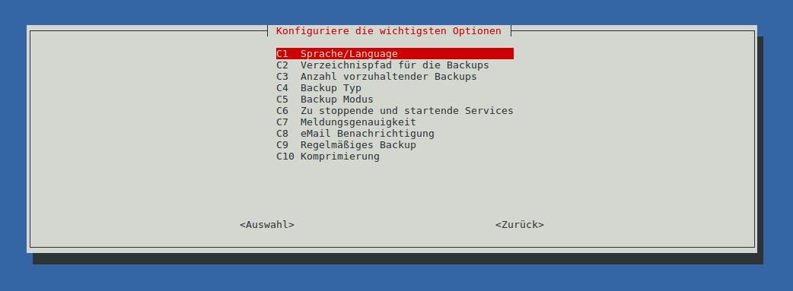

# Quickstart - Installation in 5 minutes

The documentation of *raspiBackup* has become very extensive due to the wealth of
functionality.

To make it easier to get started, this page therefore briefly explains
how *raspiBackup* can be installed and configured in just a few minutes
and then backups of the Raspberry can be created.

The chapter [Configuration examples](configuration-examples.md) contains some inspiration for using *raspiBackup*. These can be used to familiarize yourself with the parameters and thus help with the later
configuration during the installation.

Restoring a backup is described in detail [on a separate page](restore-intro.md).
The primary platforms (Linux, Mac or Windows) of the users are also covered there.

**Note:** *raspiBackup* user [Franjo G](https://forum-raspberrypi.de/user/57610-franjo-g/) has written very good
[instructions for installing, configuring and using raspiBackup](https://forum-raspberrypi.de/article/7-raspibackup-installation-grundeinstellungen-erstes-backup-und-restore/) in the German Raspberry forum. In any case it's worth taking a look at *raspiBackupDialog*, which simplifies the usage of *raspiBackup* even further. See [extension scripts](https://framps.github.io/raspiBackupDoc/extension-scripts.html) for details.


## Installation options

There are different ways to install and configure *raspiBackup*:

1) Download and invoke the installer on the command line to install *raspiBackup*. This is the most convenient method.
   ```
   curl -sSLO --fail https://raw.githubusercontent.com/framps/raspiBackup/master/published/raspiBackupInstallUI.sh && sudo bash ./raspiBackupInstallUI.sh
   ```
   [Here](installer.md) you will find some detailed information about a few configuration options.

2) Download and invoke the installer on the command line to install *raspiBackup* with its default configuration.
   Intended for experienced *raspiBackup* users who want to install *raspiBackup* on additional Raspberries.
   ```
   curl -sSLO --fail https://raw.githubusercontent.com/framps/raspiBackup/master/published/raspiBackupInstallUI.sh && sudo bash ./raspiBackupInstallUI.sh -i
   ```
   [Here](installer.md) the standard configuration is described.

3) [Manually without installer](using-raspibackup-without-installation.md) for folks who don't trust the installer and sudo.

   The source code for *raspiBackup* and the installer can be viewed on the following pages.

   - [Download *raspiBackup*](https://github.com/framps/raspiBackup/blob/master/raspiBackup.sh)
   - [Download raspiBackupInstallUI](https://github.com/framps/raspiBackup/blob/master/installation/raspiBackupInstallUI.sh)


## The *raspiBackup* installer

*raspiBackup* has a menu-driven UI installer and configurator,
`raspiBackupInstallUI`, with which *raspiBackup* can be easily installed
and its basics configured, like with `raspi-config`.

There are also update functions for the installer itself and for *raspiBackup*.

Installation is carried out via menus and selection lists. The
menu languages available are German, English, Finnish, Chinese and French.

In the [*raspiBackup* presentation video on Youtube](https://youtu.be/PuK_FNK674s)
a demo of the installation is shown.

<a name="backup-directory"></a>
## Preparation: The backup target/backup directory

In the standard configuration, *raspiBackup* assumes that there is a
mountpoint `/backup` under which the backup directory is mounted.

This mountpoint should be created before the installation and then
the **external** backup directory/device (USB disk, USB stick, NFS drive, ...)
should be mounted there.

In the following example, an external USB disk or USB stick is mounted:

```
sudo mkdir -p /backup
sudo mount /dev/sda1 /backup
```

Another line must then be inserted in `/etc/fstab`. The PARTUUID
from the following example must be adapted and the PARTUUID to use is displayed with `lsblk -o PARTUUID`.

```
PARTUUID=aeddf698-02    /backup     ext4    defaults,noatime,nofail,async   0  0
```

Depending on the desired backup type, *raspiBackup* requires a certain file system for this partition.
This is explained in chapter "[Which file system can be used on the backup partition?](which-filesystem-can-be-used-on-the-backup-partition.md)".
Please note: [Why is it better not to use dd as a backup type?](why-shouldn-t-you-use-dd-as-backup-type.md).

**Before** the first backup, it is advisable to check/ensure that the
correct backup target or the correct backup partition is used.

The following command is helpful here:

```
lsblk
```

<a name="download-commands"></a>
## Download and install the installer

To download, install and start the *raspiBackup* installer, enter the following
in the command line on the Raspberry or, much better, copy and
paste it into the command line:

```
curl -sSLO --fail https://raw.githubusercontent.com/framps/raspiBackup/master/published/raspiBackupInstallUI.sh && 
sudo bash ./raspiBackupInstallUI.sh
```

**Note**: A manual installation without `sudo` usage is documented on
[this page](manual-installation-and-configuration.md).

Now you can start the installation with a standard configuration and
change the essential settings in the configuration menu.



All further settings have to be made in the configuration file
`/usr/local/etc/raspiBackup.conf` with an editor.

Finally, the weekly backup can be activated with *raspiBackup*.

The installer can be invoked again at any time in the command line with
`sudo raspiBackupInstallUI` to change the configuration.


## Systemd to start the backup automatically at regular intervals

After both backup and restore have been successfully tested and the
services to be stopped before the backup have been configured, *raspiBackup* can be scheduled via *Systemd timer*
for automatic execution at the desired interval.

The Systemd configuration should always be changed with the installer.

Any manual changes in the *Systemd* configuration file `/etc/systemd/system/raspiBackup.timer`
should be made "carefully". They could easily lead to
the installer no longer being able to change the configuration file.

Should there be a problem after all: The installer always creates a debug log in the current directory in file
`raspiBackupInstallUI.log`, which helps to find the cause.

## The notification by eMail

Notifications by eMail require a correctly configured local MTA
such as *Postfix*, *nullmailer*, *msmtp* or *Exim4*. If *Pushover*, *Slack* or *Telegram*
is used, the configuration file of *raspiBackup* must first be manually updated
with the required configuration data.
See chapter [General configuration](general-config-options.md).
A notification test can be carried out with the option `-F`.

## Create a backup ...

Since the backup partition is already mounted under `/backup` [(see above)](#backup-directory),
the backup can be started. Perhaps with detailed messages the first time:

```
sudo raspiBackup -m detailed
```

Depending on the size of the installation, this may of course take a little longer...


## ... and test a restore!

**A restore test should then definitely be carried out** ([Link to the
restore documentation](restore.md)) to verify that a consistent backup is being
created and to familiarize yourself with the restore procedure.

**Because:
A backup is useless if, at the moment you want to restore it,
you realize that it is not usable.**

The entire restore process should be run through from time to time to test
whether the backups created are in order and whether a system can be restored to working order.
*raspiBackup* reminds you at regular intervals
to perform a restore test. The reminder interval can be configured.
The default value is 6 months.

Testing is also particularly important when a new system with a new operating system is
backed up again with *raspiBackup*. There are repeatedly
changes with new operating system versions that can lead to the restore no longer working.

<a name="next-steps"></a>
## Further steps

After the first backup has been successfully created and restored,
you should take a quiet hour to find out about all the other options of
*raspiBackup* and use them as required.

In any case, it makes sense to read through the [FAQs](faq.md).

Each option can be defined in the configuration file `/usr/local/etc/raspiBackup.conf`,
so that no further options need to be specified when *raspiBackup* is invoked.

Details can be found in the chapter [Invocation and options - Backup - Options](backup-options.md)
and for the options that can **only** be set via the configuration file,
in the chapter [Invocation and options - Backup - Configuration](backup-config-options.md).

Also useful: [raspiBackupDialog - a convenient helper script for raspiBackup](raspibackupdialog-a-convenient-helper-script-for-raspibackup.md),
which simplifies the use and invocation of *raspiBackup*.

## Uninstallation

If it turns out that *raspiBackup* does not meet your requirements,
[uninstallation](installer.md#uninstallation) is available via the *raspiBackup* installer.
However, it is advisable to first ask via one of the [contact channels](introduction.md#contact_options)
whether the missing functionality is perhaps available in *raspiBackup* after all.

[.status]: translated
[.source]: https://linux-tips-and-tricks.de/de/installation


